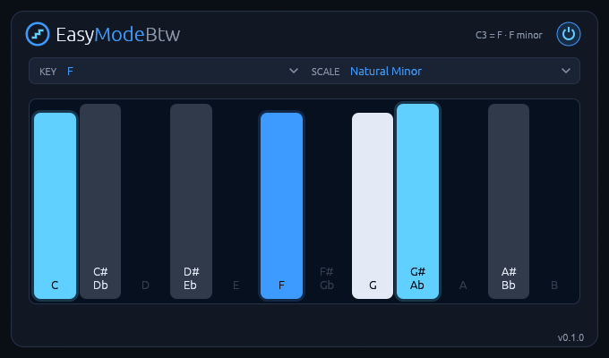

# EasyModeBtw

**Play any scale on the white keys, as chords, strums or arpeggios.** A MIDI effect for Linux:
the white keys play the notes of the scale you pick with its root on middle C, and each key can
play a chord of the scale instead, strummed like a guitar or broken into an arpeggio on the beat.
CLAP for Linux.



Pick F minor, and the white keys from C3 upwards play F G Ab Bb C Db Eb F. Put EasyModeBtw in
front of any instrument and you can't play a wrong note. Turn on CHORDS and every white key plays
the scale's chord on its note; turn on the strum or the ARP and those chords come out one note at
a time. It works like the Easy Mode of Native
Instruments' Smart Play. It has no audio inputs or outputs: it only rewrites MIDI notes.

It runs natively on Linux, with no network access and no telemetry.

**[Read the manual](manual.md)** for every control and how to use it.

## Features

- **20 scales on 12 keys:** Chromatic, Major, Natural, Harmonic and Melodic Minor, Dorian, Phrygian, Lydian, Mixolydian, Locrian, Major and Minor Pentatonic, Blues, Whole Tone, Spanish Phrygian, Double Harmonic, Hungarian Minor, Hirajoshi, In Sen and Lydian Dominant.
- **Chords on every key:** Triads, Sevenths, Sus2, Sus4, Add9 or Power, or the chord Jazz, Bossa, Soul or Folk most often puts on that note. Or Thirds, Sixths and Octaves: each key's note with one partner above it, for a harmonised melody. The black keys play borrowed major chords.
- **A key map that suggests:** each key names the chord it plays, and three good chords to play next light up.
- **Strum:** a chord's notes start one after another, up to 100 ms, up and down in turn, one way, or each strum at random. No added latency.
- **Arpeggiator on the host's beat:** eight patterns, from Up and Down to a pop-piano figure, 1/4 to 1/32 with dotted and triplet rates, up to 4 repeats climbing an octave or up the scale, swing, stairs that show what it plays, and a rhythm ring of up to 32 steps with a shelf of 26 rhythms, whose steps can roll two to four times.
- **HOLD on a sustain pedal:** let go and what the keys play goes on, in every mode.
- **See what you play:** the PLAY page draws a thread from every key you hold to the notes it sends. Click the keys with the mouse to try everything without a keyboard.
- **No stuck notes:** a note-off always ends the notes its note-on started, even if you change the key, scale or chords while holding it.
- **Everything else passes through:** pitch bend, mod wheel and other CCs, channel pressure and program changes are untouched.
- **Zoom** from 100 to 200 %.
- **No network access and no telemetry.**

## Install

Download the latest version from the [Releases page](https://github.com/jelly-comet/EasyModeBtw-release/releases),
or with these commands:

```bash
curl -LO https://github.com/jelly-comet/EasyModeBtw-release/releases/download/v1.2.5/EasyModeBtw-1.2.5-linux-x86_64.tar.gz
curl -LO https://github.com/jelly-comet/EasyModeBtw-release/releases/download/v1.2.5/EasyModeBtw-1.2.5-linux-x86_64.tar.gz.sha256
sha256sum -c EasyModeBtw-1.2.5-linux-x86_64.tar.gz.sha256 && tar xzf EasyModeBtw-1.2.5-linux-x86_64.tar.gz
cd EasyModeBtw-1.2.5-linux-x86_64
```

Install for your user:

```bash
mkdir -p ~/.clap
rm -f ~/.clap/easymodebtw.clap && cp easymodebtw.clap ~/.clap/
```

Or for all users:

```bash
sudo mkdir -p /usr/lib/clap
sudo rm -f /usr/lib/clap/easymodebtw.clap && sudo cp easymodebtw.clap /usr/lib/clap/
```

Removing the old copy first avoids overwriting a file a running host has loaded. Then rescan plugins
in your DAW.

Since 1.0.0 releases have no VST3. A VST3 from an earlier release keeps working but no longer
updates; a project that used it takes the CLAP in its place. To remove the old copy:
`rm -rf ~/.vst3/easymodebtw.vst3`, or `sudo rm -rf /usr/lib/vst3/easymodebtw.vst3`.

To uninstall:

```bash
rm -rf ~/.clap/easymodebtw.clap ~/.vst3/easymodebtw.vst3
```

## Requirements

- Linux x86-64 with glibc 2.31 or newer (Ubuntu 20.04, Debian 11, Fedora 32 and newer)
- A CLAP host
- X11 or XWayland, and a Vulkan driver for the editor

Releases contain the CLAP plugin only.

## License

MIT, see [LICENSE](LICENSE). The licenses of the third-party code in the binaries are in
`THIRD-PARTY-LICENSES.txt` in each release archive.

VST is a registered trademark of Steinberg Media Technologies GmbH. CLAP is an open standard
by the free-audio project. Smart Play is a product feature of Native Instruments. EasyModeBtw is
an independent project, not affiliated with or endorsed by Steinberg or Native Instruments.
