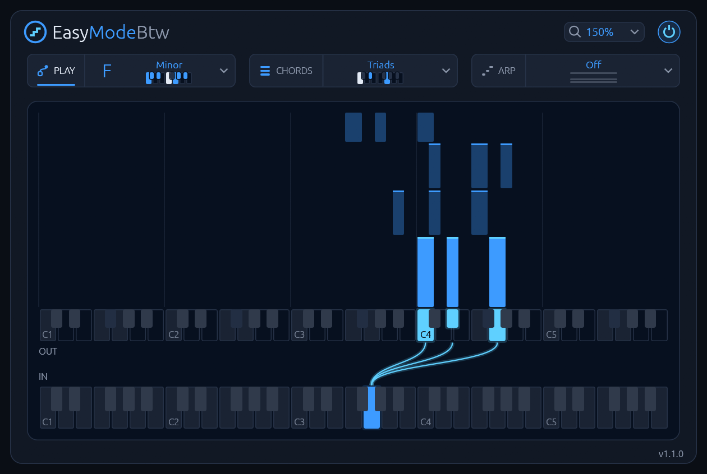
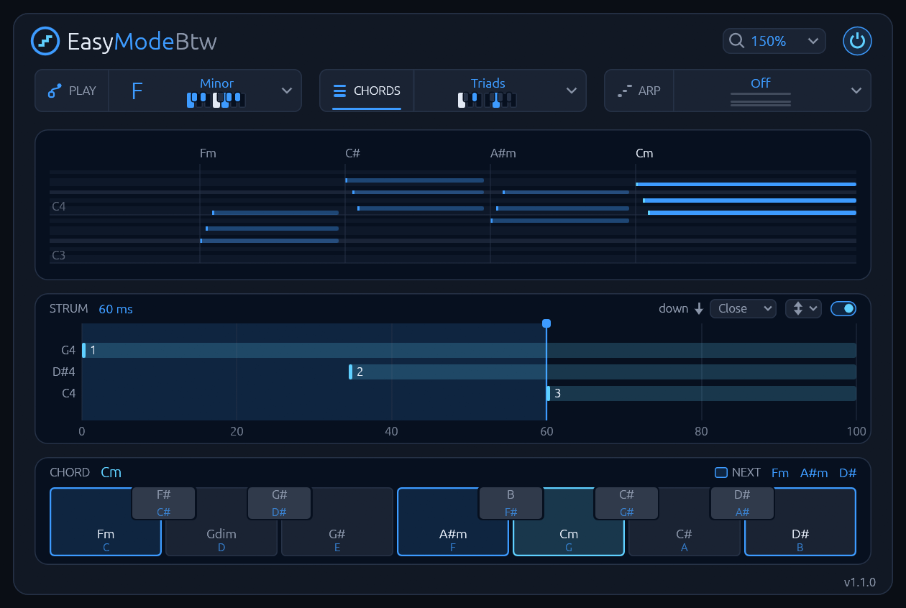
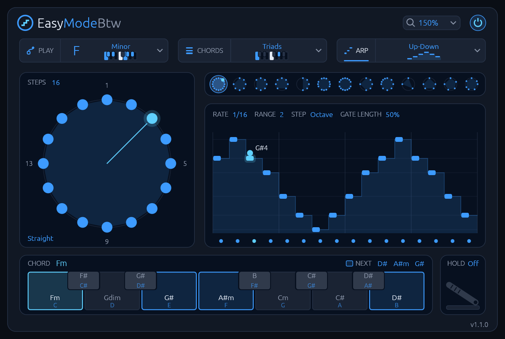

# EasyModeBtw manual

**Play any scale on the white keys, as chords, strums or arpeggios.** A MIDI effect for Linux:
the white keys play the notes of the scale you pick with its root on middle C, and each key can
play a chord of the scale instead, strummed like a guitar or broken into an arpeggio on the beat.

Version 1.1.0. To install it, see the [README](README.md).

## Getting started

EasyModeBtw goes **in front of an instrument**, because it changes the notes the instrument
receives.

- **Bitwig Studio:** put it in the Note FX slot of an instrument track, or anywhere before the
  instrument in the device chain.
- **Other hosts:** use it as a MIDI effect (a CLAP note effect) in front of an instrument.

Choose a KEY and a SCALE, then play the white keys from middle C upwards: every note is in the
scale. Then set CHORDS to Triads and play the white keys again: each one plays a chord. Open the
PLAY page to see which notes every key sends.

## The controls

The header holds the zoom select and the power switch. Below it one row holds three selectors:
the key and scale, CHORDS and ARP. A click on a selector's icon or caption shows its page (PLAY,
CHORDS or ARP), and a click on its value opens its list of tiles. The scales and chord sets have a
little keyboard with their notes lit, the chord sets showing what they play on the key you last
held; the arp orders have their stairs. Hover a tile and it performs. Under the row is the page.

| Control | Range | Default | What it does |
| --- | --- | --- | --- |
| **Power switch** (top right) | On / Off | On | Off, every event passes through unchanged. |
| **KEY** | C to B | C | The scale's root: the note middle C plays. |
| **SCALE** | 14 scales | Chromatic | The scale the white keys walk through. |
| **CHORDS** | Off, Triads, Sevenths, Sus2, Sus4, Add9, Jazz, Bossa, Soul, Folk, Power | Off | Off plays one note per key; the others a chord on every key. |
| **ARP** | Off, Up, Down, Up-Down, Converge, As Played, Chord, Random, Piano | Off | Off sends each key's note or chord at once; the others play it one note after another on the beat. |
| **Strum switch** (CHORDS page) | On / Off | Off | Off, a chord's notes start together. |
| **STRUM** (CHORDS page) | 0 to 100 ms | 20 ms | How long a three-note chord takes to strum, first note to last. Drag on the strum display to set it. |
| **Strum direction** (CHORDS page) | Up and down, Up, Down | Up and down | Which way the strums go. |
| **Strum voicing** (CHORDS page) | Close, Guitar | Close | How a strummed chord is laid out. |
| **RATE** (ARP page) | 1/4, 1/8., 1/8, 1/8T, 1/16, 1/16T, 1/32 | 1/16 | How far apart the arp's steps are. |
| **RANGE** (ARP page) | 1 to 4 | 1 | How many times the run plays, each time higher. |
| **STEP** (ARP page) | Octave, 2nd, 3rd, 4th, 5th, 6th | Octave | How far each repeat climbs: an octave, or that far up the scale, so it never leaves the key. |
| **GATE LENGTH** (ARP page) | 5 to 100 % | 50 % | How long each note lasts, as a share of its step. 100 % lasts until the next note. |
| **HOLD** (ARP page, the sustain pedal) | On / Off | Off | Let go and the arp plays on, until the next chord you play after letting every key go. |
| **Rhythm shelf** (ARP page) | Straight and 12 rhythms | | Loads a rhythm into the step ring. |
| **Step ring** (ARP page) | 1 to 32 steps | 16, all playing | Which steps play and how loud. Saved with the project. |
| **Zoom** (header) | 100 to 200 % | 100 % | Sizes the window. |

The version is in the bottom-right corner, and clicking the logo opens
[the plugin's page](https://rmnhofma.github.io/plugins/easymodebtw/).

## How to use it

### What the white keys play

Every white key is one step of the scale. Middle C (C3, MIDI note 60) plays the root, the next
white key up plays the next note of the scale, and white keys below middle C walk down it. With
CHORDS off, black keys play nothing.

| Scale | White keys C3 D3 E3 F3 G3 A3 B3 C4 play |
| --- | --- |
| C Major | C3 D3 E3 F3 G3 A3 B3 C4 (unchanged) |
| F Natural Minor | F3 G3 Ab3 Bb3 C4 Db4 Eb4 F4 |
| G Major | G2 A2 B2 C3 D3 E3 F#3 G3 |

Roots C to F sit on or above middle C, and F# to B just below it, so the playable range stays
centred. A five-note pentatonic repeats every five white keys, so your hands cover more than an
octave for the same reach, which makes fast runs easy.

**Chromatic**, where a new instance starts, plays every key, black ones too, each its own note moved
so middle C plays the root: in C, the keyboard as it is.

### Chords

With CHORDS on, each key plays a chord built on its note.

- **Triads, Sevenths, Sus2, Sus4, Add9:** the scale's own chords. In C major the white keys play
  C Dm Em F G Am B°.
- **Jazz, Bossa, Soul, Folk:** the chord that genre most often puts on each note, counted from
  thousands of lead sheets. In C major, Jazz plays Dm7 on D, G7 on G, Cmaj7 on C and A7 on A.
- **Power:** the root and a perfect fifth on every key, as rock plays it.

The black keys play a major chord on their own note (bII, bIII, #IV, bVI, bVII), the chords songs
borrow from outside the key. Each chord plays in root position on the note its key plays alone, the
same notes the arp plays from.

The **CHORDS page** shows the last four seconds of notes with each chord's name, the strum, and a
key map: one octave of keys, each naming the chord it plays. The chord sounding glows on its key,
and three chords that would sound good next are lit on theirs and named after NEXT. Where a white
and a black key play the same chord, the white one lights. Click a key on the map to hear its
chord, in the octave of the last note you played: near its top it plays soft, near its foot loud.

### Strum

Turn on the switch on the strum display and a chord's notes start one after another, as a
guitarist strums. STRUM is a three-note chord's strum; more notes take longer, fewer less. Low to
high the notes come evenly; high to low they speed up, as an up stroke does. Start around 20 to
40 ms for a soft strum and 60 to 100 ms for a slow, harp-like one.

The direction select picks up and down in turn, only up or only down. The voicing select lays
each chord out **Close**, in root position, or as a **Guitar** grips it: the root low in the
bass, then the fifth, the root or seventh, the third and the fifth again. The strum only delays
notes, so it adds no latency.

### Arpeggiator

With ARP on, each key's note, or with CHORDS its chord, plays one note after another on the host's
beat. While the transport stands it runs at the host's tempo from the first key.

- **Up, Down, Up-Down, Converge, As Played, Random:** the chord's notes in that order.
- **Chord:** the whole chord on every step; with the strum on, each step is strummed, up and down
  in turn, like a strumming hand.
- **Piano:** the way pop pianists break a chord: root, fifth, octave, then the third and fifth
  above, weaving back down, the top note loudest.

RANGE plays the run up to four times, each time higher by STEP. A chord played a little late still
starts on its root.

The **ARP page** shows the stairs: what the arp plays over one turn of its rhythm, a ball hopping
from note to note with the note's name and the ring's rests as gaps. RATE, RANGE, STEP and GATE
LENGTH are in their header: click one for its menu, or drag it up and down, or scroll. Drag the end
of any note to set GATE LENGTH.

Beside the stairs is the step ring. Click a step to turn it on or off, drag it towards the centre
to make it softer and away to make it louder, and double-click it for full. Drag around the ring
elsewhere to turn the rhythm, and drag the number of steps up or down to change it. The shelf of
tiny rings loads a pattern into it: hover one to see it over the big ring with its name, and click
to load it. It has Straight, eight of the commonest broken-chord bars in pop piano, and the
tresillo, cinquillo, bossa and bell rhythms.

Below are the keys from the CHORDS page, playable with the mouse, with the chords to play next lit
on them; with CHORDS Off each key names the note it plays. HOLD is the sustain pedal beside them:
click to stomp it, and it stays down.

### The PLAY page

The PLAY page shows what EasyModeBtw does to your playing. The keys you press are on the lower
keyboard, the notes sent on the upper one, with a thread from each key to every note it started,
and the notes sent rise above. Click or drag on the lower keyboard to play with the mouse.

Notes played with the mouse go out of the plugin like any it sends; a DAW records them only where
it records the plugin's output.

## Good to know

- **Latency:** none. The strum and the arp only delay notes.
- **Automation:** KEY, SCALE, CHORDS and ARP changes take effect at the exact sample they are drawn
  at.
- **Saved projects:** a project saved with 1.0 keeps its settings, but its chords now play in root
  position on each key's own note, so one using CHORDS sounds different. A GATE LENGTH saved above
  100 % keeps its value until you touch the control. A project saved with 0.1.x plays as before,
  except one saved with SCALE on Chromatic, which now plays every key.
- **Changing settings while you play:** a held note keeps sounding until you let go of its key, and
  then the right notes end, so nothing gets stuck. Switching ARP or the power switch ends what
  sounds; press the keys again.
- **Other MIDI:** pitch bend, mod wheel and other CCs, channel pressure and program changes pass
  through untouched.
- **Zoom:** the project remembers it, and a new window opens at the zoom you last chose in any
  PluginsBTW plugin.
- **Hosts:** the CLAP passes `clap-validator`.
- **Display:** X11, or XWayland on a Wayland desktop, with a Vulkan driver.

## Troubleshooting

- **The plugin doesn't show up:** check that `easymodebtw.clap` is in `~/.clap` or
  `/usr/lib/clap`, then rescan plugins in your DAW.
- **The editor window stays black or doesn't open:** check that a Vulkan driver is installed.
  The `vulkaninfo` tool from `vulkan-tools` should list your GPU. Bitwig Studio writes plugin
  errors to `~/.BitwigStudio/log/engine.log`.
